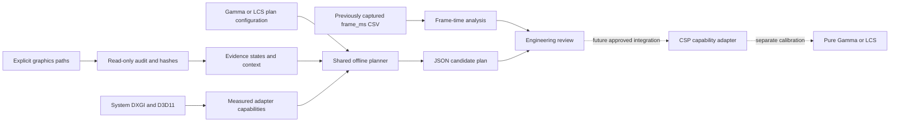

# RestoVisuals architecture, Phase 0E checkpoint

Phase 0E records the [version-specific HDR contract review](PHASE0E_HDR_CONTRACT.md).
The reviewed declarations do not establish the source representation or returned
canvas retirement boundary. Native neutral rendering remains **NO-GO**; no runtime
implementation, rendering stage or ownership boundary changes in this checkpoint.
Resize registration can disable automatic host reload, and unload callbacks are
best effort. Neither may be used to invent a safe canvas disposal deadline.

Phase 0D additions: [Dream/WeatherFX/Pure ownership](DREAM_WEATHER_ARCHITECTURE.md)
and an original finite host probe now extend this architecture. The probe reuses
the existing observer and stages only uniquely owned files. Actual preview361/
Gamma execution delivered 106 main callbacks and a quiet owned-stop witness;
the experimental files and settings were fully recovered. No Pure named effect
or replacement bridge is implemented. A neutral pass remains blocked by actual
input format/encoding/exposure and returned-canvas lifetime contracts.

Future controls retain Camera Realism, Enhanced Photorealism (default) and
Cinematic Realism, bounded warmth/saturation/contrast/highlight/shadow/clarity
controls, separate monitor calibration and custom presets. Weather-responsive
calibration reads verified conditions while Pure/CSP retains weather/exposure
ownership. Photo Studio/softbox and material enhancements remain deferred.

## Decision and current implementation

Use one vendor-neutral engine with capability adapters and separate Pure
calibrations. Begin with an offline control plane and supported CSP/Pure
integration research. Do not build an injector, custom upscaler or replay MCP.

The implemented control plane is Python 3.11+ standard library. It has no package
downloads, installation hooks, telemetry service or game-setting writer.
Windows-only GPU detection uses system DXGI/D3D11 through ctypes; the planner,
schema validator, file audit and frame-time mathematics are independently usable.
A read-only Lua observer now exists with explicit host/version/build/mode gates,
bounded diagnostic samples and owned subscription cleanup. LuaJIT contract tests
are supplemented by the narrowly verified native preview361/Gamma receipt above.
No experimental component remains installed. The native host adapter wraps only
the documented FFI build getter in its own proxy and retains exact version/build
checks. Input semantics/lifetime and neutral output still gate rendering.
The optional Lua test dependency is isolated from the core CLI.

The explicit `gpu-validate` command owns a windowless D3D11 context and executes
original pixel/vertex shaders, reads RGBA32F/RGBA16F output with row-pitch handling,
and checks strict identity before color changes. It is a separate hardware
validation path, not a CSP renderer, injector, game timing source or deployed
effect. See [Phase 0B evidence](PHASE0B_RUNTIME.md).

## Module contracts

| Module | Inputs and output | Implemented boundary |
|---|---|---|
| Environment audit | explicit roots -> sanitized observations and relative IDs/hashes | Selected files and top-level PP INIs only; no recursive asset inventory |
| GPU capability engine | DXGI adapters + temporary D3D11 devices -> vendor/device, software flag, dedicated bytes, actual feature level | No swap chain, process attachment, game adapter guess or vendor SDK |
| Configuration | JSON profile -> strict validated fields | Schema version 1; reject unknown/missing fields, types, invalid ranges and unauthorized CSP tracks |
| Capability adapters | context + per-capability evidence states -> feature eligibility | Observed labels stay observations. Optional eligibility requires tested evidence for matching CSP, Pure mode, render mode and resolution |
| Performance planner | config + explicit adapter + capability report -> candidate JSON | Proposed memory class and resource ceiling; no setting writes, FPS prediction or runtime certification |
| Benchmark analysis | display interval CSV -> average FPS, 1% low and percentiles | Duration-based average, documented slowest-frame definition, explicit warmup; no capture source certification |
| Read-only runtime observer | supplied CSP/Pure APIs -> copied bounded receipt | LuaJIT contracts and one native preview361/Gamma run; every PP callback returns nil, no settings/texture access; owned stop witnessed |
| Isolated GPU validation | explicit adapter + original source -> readback comparison and timestamps | Actual D3D11 execution; no game/window/swap chain, exact identity gate, owned resources released |
| Rendering integration | stage/format/ownership + approved operations | Future verified CSP/Pure host and named effect lifecycle; no active game module deployed |
| Replay integration | versioned capture intent and visual profile ID | Future external MCP; no camera/replay implementation in Phase 0 |

## CSP and evidence model

Only `0.2.11` and `0.3.0-preview361` are accepted target tracks. Track recognition
does not imply runtime compatibility. No version comparison automatically enables
a newer feature. Runtime capability states are `unknown`, `documented`,
`observed_locally`, `tested_validated`, `proposed` or `unavailable`.

Installed labels produce `observed_locally`. Capability reports carry a reviewable
evidence ID and exact context. The planner requires all context fields to match
before permitting optional features. Tests use synthetic evidence reports to
exercise gates; these are not measurements from the game. A future runtime
collector must verify symbols, loaded libraries, prerequisites and buffer
availability, record source/hashes/driver/context, and invalidate evidence after
changes. Until that exists, do not hand-edit an observation into runtime proof.

The official stable SDK reference identifies build 3465, alongside preview3898.
The observer gates both exact pairs. Stable's `OLD_IMPLEMENTATION` is boolean;
preview reuses it as an upscaler method enum. The audit maps these by version
and refuses unknown IDs/versions. Stable lacks the preview simulation `isHDR`
field; optional FFI fields are protected independently. See
[the version-matched reference](CSP0211_REFERENCE.md).

Temporal FSR requires independent evidence for its integration plus depth,
motion, jitter and history resets. FSR3 upscaling does not enable frame generation.
Native remains selectable. Extra FX, post-processing, render-mode restrictions,
payload availability and original motion blur belong in the integration probe's
validated claim; the offline planner does not inspect or alter their live state.

## Pure ownership and visual processing

Gamma and LCS use separate profile documents with identical engine contracts.
They have equal hardware standing. Their current documents describe proposed
plan inputs, not visually calibrated PP presets. The saved active Gamma selection
does not establish LCS behavior.

Pure should retain exposure/weather ownership initially. Future RestoVisuals
processing must explicitly identify input/output color encoding and bind at a
verified supported stage. Avoid two exposure controllers, repeated tonemapping,
duplicated bloom or multiple sharpeners. Start with no extra render targets and
one optional fused color pass only after numerical, compile, runtime and visual
gates. Night, rain, fog, sun/headlights and reflections require both calibrations.
Existing CSP control adjustments must be labeled as configuration operations.
Only original shader source may be called a RestoVisuals rendering effect.

## Low-memory policy

| Candidate class | Nominal target | Proposed incremental effect ceiling |
|---|---|---|
| Ultra Lite | 2 GB | 24 MiB |
| Optimized | 3-4 GB | 48 MiB |
| Balanced | 6 GB | 96 MiB |
| Enhanced | 8 GB | 128 MiB |

These are design ceilings, not profiled budgets or minimum hardware guarantees.
Capacity boundaries tolerate reserved adapter memory: 2.5, 5.5 and 7.5 GiB
separate the proposed classes; below 1792 MiB is outside the initial targets.
Software adapters and unmeasured/below-11_0 feature levels cannot receive an
eligible class. Unvalidated vendors get only a conservative exploratory class.
AMD/NVIDIA receive the same policy. A requested class cannot raise the capacity
ceiling. Bandwidth, driver behavior and displayed frame times remain required
before recommending deployment on any card.

One proposed full-resolution RGBA16F output costs `width * height * 8` bytes
without MSAA, mips, array layers or history. At 1080p that is 15.82 MiB; at 4K,
63.28 MiB. The planner disables this pass above its tier ceiling. Current default
plans request no effect surface. CSP's own resources and FSR working sets are
unknown and excluded, so this arithmetic cannot certify total VRAM headroom.
Prefer CSP-owned targets, pass fusion, reuse and reduced resolution over extra
history buffers. Do not confuse dedicated capacity with available memory.

## Measurement and future adaptation

The user-supplied target FPS defaults to 60 in examples; it is an input, not a
measured result or guaranteed target. A frame-time budget is `1000 / target_fps`.
Average FPS uses total displayed frames divided by elapsed display time. The
1% low is reciprocal mean of the slowest ceil(N*0.01) frame intervals. Percentiles
use nearest rank. Require longer consistent captures for certification and report
sample count, warmup, source, driver, settings, resolution and native baseline.

CSP exposes candidate performance APIs but their units and wall-clock behavior
need runtime validation. Simulation dt is replay/pause dependent. DXGI budget in
a helper is not the game's usage. In-process timing and memory collection are
future work. No real-time adaptation is implemented. When added, use hysteresis,
minimum dwell, bounded setting deltas and restore-on-error behavior; never
automatically change an upscaler requiring a restart.

## Reversibility, packaging and tradeoffs

No apply operation exists in this checkpoint. Later application must snapshot
only owned keys, hash the baseline, present a concrete diff, check drift, apply
through supported interfaces, and verify rollback before touching known-good
configuration. Preserve other mods and enable one module at a time. Runtime
errors must disable the optional module and retain native rendering.

Python keeps the initial tools inspectable and dependency-free; it is not the
planned per-frame runtime or end-user installer. Lua is the expected thin CSP
adapter, HLSL the optional effect language. Native C++ is deferred until a measured
integration requirement exists. ReShade would add hook/order/compatibility risk
and is not an initial dependency. Public repository licensing remains undecided;
no third-party source, paid Pure assets or binaries are vendored.
