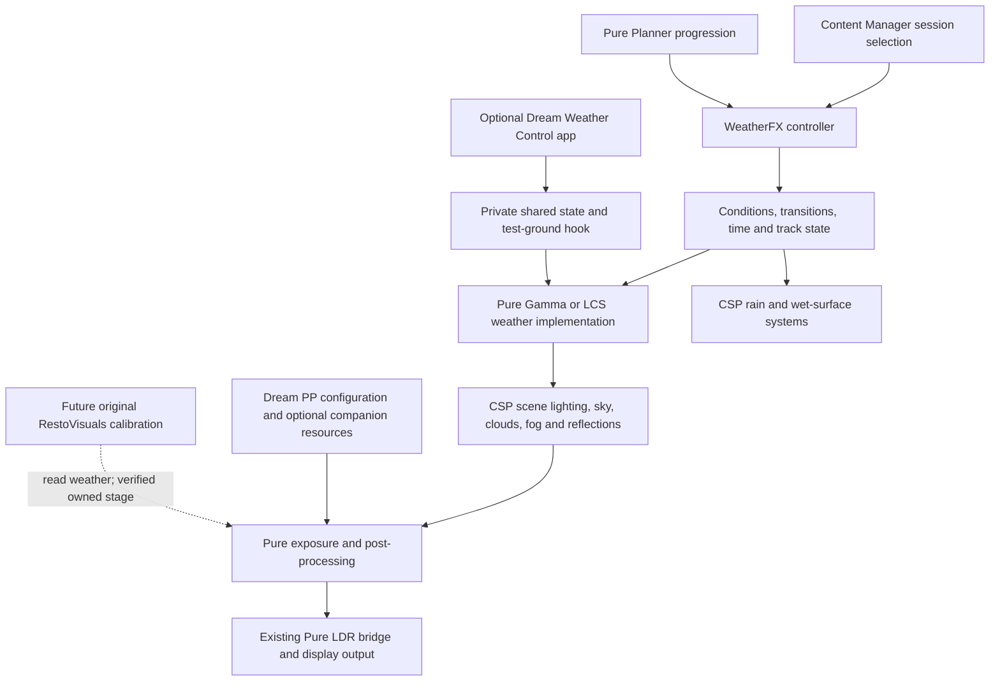

# Dream, WeatherFX and Pure architecture

Phase 0D, 2026-11-04. Bounded read-only investigation of the installed packages.
No proprietary implementation, preset, LUT or parameter table is reproduced.
Runtime behavior remains unconfirmed until an actual game receipt is obtained.

## Observed installation and visual direction

Installed metadata still identifies CSP 0.3.0-preview361/build3898, CM
0.8.2913.40776, and Pure Gamma/LCS 3.50. Saved configuration selects Pure Gamma,
`pureCtrl static`, and Dream Realism 7.3 Gamma with post-processing enabled.
These are on-disk observations, not a claim about a running renderer.

The approved reference is `RestoVisuals_Visual_Target_01_Photorealism.png` in the
checkout root, SHA256
`7dd8d8a104698493fdf8745730283e19da43cf35f771f555ee746fa75cd480cf`.
It is preserved as an owner-supplied untracked visual reference; the image itself
is not republished. Its bright outdoor lighting, distinct material response,
readable shadows and restrained optical effects guide future calibration.
It is not an Assetto Corsa runtime result or a geometry-reconstruction promise.

## Ownership and processing layers

The [public CSP WeatherFX implementation context](https://github.com/ac-custom-shaders-patch/acc-lua-sdk/blob/main/ac_wfx_impl.lua)
and [controller context](https://github.com/ac-custom-shaders-patch/acc-lua-sdk/blob/main/ac_wfx_controller.lua)
are distinct script environments. Current upstream is explanatory primary
documentation, not version-matched certification. The installed build3898 SDK
and the privately retained build3465 reference remain the version-specific evidence.

| Concern | Installed source/configuration observation | Ownership and remaining limit |
|---|---|---|
| Weather selection/progression | The installed Pure controller reads session weather, temperature, wind/date/track inputs and supplies conditions through CSP; its static variant delegates with a distinct controller mode | CM/controller/Planner owns selection and progression. Installed static selection does not prove a dynamic plan was running |
| Sun and sky | Pure's weather context renders the environment. The optional Dream hook also calls CSP sun/sky-direction and atmosphere setters | Those adjustments belong to the weather implementation/hook, not the PP INI. Do not reproduce Dream's calibration constants |
| Clouds, fog and rain | Dream's optional controls send cloud/fog/weather choices to a separate weather-context hook; its source adjusts atmosphere and fog. CSP provides separate rain/wet-surface rendering systems | A visible control does not establish working rain, current wetness, controller transition or another script's active override |
| Lighting/reflections | The optional Dream hook changes ambient/specular/reflection controls through CSP weather APIs | It adjusts an existing renderer; no separate Dream reflection tracing engine is established. Materials, car/track content and CSP settings remain relevant |
| Exposure/tonemapping | Pure exposes CBE/YEBIS exposure queries and controls; the selected Dream PP INI supplies engine/Pure PP configuration | Preserve Pure exposure ownership. Neither a shader-space flag nor an INI proves texture encoding or the exact order of every stage |
| Color/glare/bloom | The PP INI configures existing optical/color effects and references optional filter resources | Prior bounded companion/LUT absence findings remain valid in those PP paths. They do not imply the separate Weather Control app is missing or broken |
| Filter-specific UI | Installed Dream Preset Manager identifies 7.2; Weather Control identifies 1.0; selected PP INI identifies 7.3 Gamma | Distinct component labels are recorded, not repaired or assumed to be one matching release. Their current activation and cross-component behavior are unconfirmed |

## Newly located optional Weather Control

`apps/lua/DreamRealismWeatherControl` contains a manifest, app, bridge and hook
template. A separate `DreamPresetManager` app is also installed. These are outside
the PP companion paths examined in Phase 0B, so this extends that investigation.

The Weather Control source has a UI layer, shared-state transport and a
weather-context receiver. It can adjust time, sun direction, cloud/fog choices,
ambient and reflection response. Its activation is separate from mere app
presence. Its private Pure command transport can request a weather-script reset;
RestoVisuals does not use that protocol or issue that command.

Crucially, app initialization can write a shared Pure test-ground script when
its expected hook is absent. The currently installed Gamma test-ground file
matches the app's supplied template. This is static source/file evidence only.
RestoVisuals must not reuse, chain, replace or modify that shared slot, copy the
hook, monkey-patch CSP functions, or assume the app's installation mechanism is
a supported independent plugin lifecycle. No Dream app, hook or missing resource
was installed, repaired, activated or changed during this research.

## Supported interfaces and lifecycle decision

| Candidate | Evidence | Phase 0D decision |
|---|---|---|
| Standalone Lua app | Installed app SDK has fullscreen drawing and owned release callbacks, but does not declare `ac.onPostProcessing`; it does not establish a Pure SDK namespace in that context | Suitable future control surface, not a validated host for the existing PP observer |
| WeatherFX/Pure context | Installed SDK declares `ac.onPostProcessing`, callable `ac.Disposable`, `ac.onRelease`, timers and receipt I/O | Candidate for a bounded nil-returning observer. Real delivery, order and cleanup still require native evidence |
| Pure global effect directories | Both installed forks expose global HDR/LDR folder queries. Their loader evaluates a uniquely named directory's matching Lua entry during custom-script initialization | A separate candidate load path preserving Pure's bridge and occupied test-ground slot. Loader timing/re-entry and removal are not automatically certified |
| Pure named SPICE effects | Public SDK maps named HDR/LDR additions. The inspected implementations replace same-name entries and do not return an unsubscribe handle; no public remove API is established | Do not register an effect until ownership/removal is proved. Removing a UI entry or mutating a private list is not supported effect teardown |
| Direct PP filter replacement | Existing scriptable-filter slot belongs to Pure | Rejected; no replacement of Pure's LDR bridge or filter slot |

The [CSP post-processing callback documentation](https://github.com/ac-custom-shaders-patch/acc-lua-sdk/blob/main/wfx_impl/ac_postprocessing.lua)
describes a YEBIS-boundary callback and return-value ownership. The original
observer always returns nil and does not inspect/write the PP parameter object,
access textures, register a Pure effect or execute a shader. Public `onRelease`
is best effort; it is not crash recovery. The proposed finite probe also uses
explicit timer-driven stop and a subsequent callback witness.

Live deployment remains conditional on collision/reparse checks, verified
backups, rollback rehearsal, no active user game, a supported lifecycle and a
critical safety review. A workspace package is not permission to bypass a failed
condition. GUI authorization is limited to weekday 08:00-17:00 Eastern and
Content Manager is the exclusive game launcher. No live game result is claimed
by this architecture document.

## Original RestoVisuals control architecture

Preserve three future style profiles: **Camera Realism**, **Enhanced Photorealism
(default)** and **Cinematic Realism**. Treat player warmth, saturation, contrast,
highlights, shadows and clarity as bounded original controls. Keep monitor
calibration separate from creative profiles and user presets. Weather-responsive
calibration reads verified conditions; it does not become a competing weather,
exposure, bloom or tonemapping controller.

Use one shared shader/control model with separate Gamma/LCS calibration and
independent native/upscaler/FG gates. RX 5700 XT, RTX 2060 and GTX 1060 are
validation priorities, not certified hardware tiers. No DLSS 5-equivalent neural
rendering, geometry reconstruction or paid dependency is introduced. Photo
Studio/softbox remains deferred behind a future module boundary; no UI or
material-enhancement engine is implemented here.

Next native gate: prove observer loading, actual callback delivery, version/build,
context and owned stop; establish format/encoding/exposure and named-effect
removal before a neutral final-image pass. A missing required interface stops
dependent work. Real frames, matched captures and frame-time evidence remain
separate acceptance requirements.
