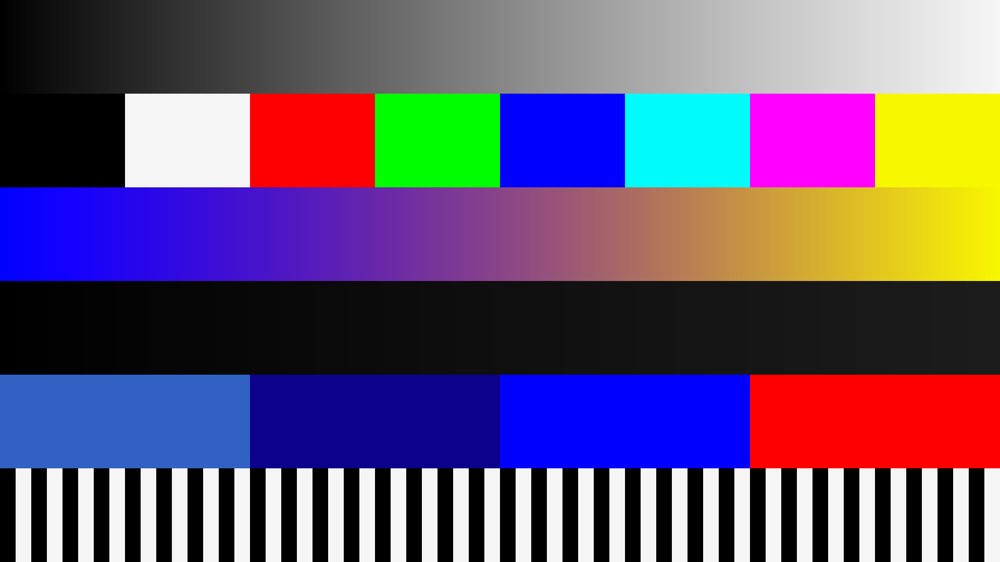

# Phase 0C runtime readiness and controlled visual evidence

Observed 2026-11-01. Tested code checkpoint:
`d83b1f4b272f40c044fa0cfbd3ce59b4154df16f`, pushed and remotely verified on
`phase0/foundation`. No merge to main or deployment to the game occurred.

## Policy and runtime readiness

The mandatory first checkpoint, `92088687608b34ea8e43b9d96ddc1a022ebb37cc`,
established the permanent freeware policy in README and AGENTS before substantial
development. Existing restrictions were preserved, the premature open-source
description was corrected, and no repository license was selected. Owner approval
is still required. See [external dependency boundaries](FREEWARE_AND_DEPENDENCIES.md).
The separately licensed game, Pure and publisher-controlled CSP/CM/filter content
are not made free or redistributable by RestoVisuals's pricing policy.

**Game runtime gate: BLOCKED.** The [isolation assessment](RUNTIME_ISOLATION.md)
documents the shared Windows-user configuration hazard, candidate hosts, exact
path/ownership requirements, acceptance tests and rollback. A copied game folder
under the same user is not established isolation. No host/account/VM/OS feature
was created, no game launched, and no reference files were deployed or changed.

The supported interface direction remains the existing read-only CSP callback
observer followed, only after real lifecycle evidence, by a uniquely owned Pure
named effect. SDK/source declarations are documented evidence; they do not prove
native loading, callback order, texture access/encoding or safe effect removal.
The Pure LDR bridge and scriptable-filter slot remain preserved. There is no new
evidence requiring an observer change, Dream resource search or proprietary code
inspection in this phase; completed Phase 0B research was not repeated.

## Implemented and validated

`gpu-demo` extends the existing D3D11 renderer rather than adding a second rendering
system. It exports original analytic calibration charts, GPU-readback PNGs,
hashes, numerical evidence and a static local comparison viewer. No third-party
source/image, game capture, browser launch, account or network service is used.

- Fixed 1280x720 and 1920x1080 profiles, RGBA32F/RGBA16F and separate explicit
  scene-linear/sRGB-display entries. Float views do not apply automatic sRGB
  conversion. Shader exposure is owned by this experiment, not inferred for Pure.
- Eight full-frame identity cases must pass byte-for-byte before any color case.
  Eight color cases use +0.25 EV, shoulder 0.25, saturation 1.0; every output pixel
  must be finite and preserve alpha exactly. A declared 3,672-pixel boundary/ramp
  grid per case checks CPU color math. Color equivalence is sampled.
- One warmup and five timestamped draws per case; disjoint results are invalid
  timings. Upload, readback, CPU validation, PNG export and presentation are
  outside the timed interval. Native query/readback waits remain bounded.
- Process-local DXGI memory samples and owned COM-reference balance; partial
  allocation failures release only the resources owned by that case.
- Output must be a new directory within the checkout's ignored `.local/` tree.
  Existing/outside/escaping paths fail before native work. Failures do not create
  a success viewer. PNGs carry sRGB technical metadata and no personal metadata.

**104 tests pass with no skips** using the optional hash-pinned LuaJIT dependency.
All original 93 tests are preserved unchanged; 11 targeted tests cover complete
identity gating, sampled-vs-full-frame checks, both encodings/precisions, PNG
CRC/known transfer values, destination safety, partial native cleanup, optional
memory-query cleanup and CLI failure status. Without LuaJIT, 79 execute and 25
explicitly skip. GPU draws remain an explicit command, outside the normal suite.

A fresh **56-file tracked-source export** of the code checkpoint passed both test
configurations and all 16 native demonstration cases without private game/SDK
files. All 16 raw readback hashes and all 24 PNG hashes matched the first run
exactly. This is reproducibility on the same host/driver, not cross-GPU proof.
The original four-identity/six-color small GPU regression also still passes.

## Hardware, numerical and timing results

Observed adapter: AMD Radeon RX 5700 XT, vendor 0x1002/device 0x731f, explicit
DXGI index 0, 8,546,471,936 dedicated bytes. The device deliberately requests
D3D feature level 11_0. Driver metadata: **32.0.21043.12001**; Python 3.14.6.
Duplicate DXGI identities remain distinct; this is not proof of two physical cards.

Original color HLSL SHA256 is unchanged:
`f762d3e4e98295b257b2fd46452023857e3b8d972c753d268835061dcf6fce88`.
Pixel bytecode remains 1788/2180 bytes. Every native identity case is exact and
every color case passes the existing precision thresholds with exact alpha.

| Controlled color case | 720p five-draw batch, ms | 1080p five-draw batch, ms | Maximum sampled absolute error, 720p / 1080p |
|---|---:|---:|---:|
| RGBA32F scene-linear | 0.18440 | 0.41384 | 1.91e-6 / 1.91e-6 |
| RGBA32F sRGB-display | 0.24752 | 0.56436 | 3.04e-7 / 2.78e-7 |
| RGBA16F scene-linear | 0.12956 | 0.29080 | 0.015625 / 0.015625 |
| RGBA16F sRGB-display | 0.25480 | 0.57592 | 0.00048828125 / 0.00048828125 |

These are first-run, non-disjoint, single batches on the selected adapter. They
are not frame distributions, stable throughput, game cost or FPS improvements.
RGBA32F tolerance is 3e-5 + 5e-6 * abs(reference); RGBA16F is 0.002 + 0.002 *
abs(reference). The larger half-float HDR error is reported rather than hidden
as exact equivalence. Alpha and identity do not use those loose thresholds.

| Profile / format | Three-texture logical payload, MiB | Sampled process local-segment usage with resources live, MiB |
|---|---:|---:|
| 720p RGBA32F | 42.1875 | 33.9375 |
| 720p RGBA16F | 21.09375 | 18.9375 |
| 1080p RGBA32F | 94.921875 | 67.9375 |
| 1080p RGBA16F | 47.4609375 | 35.9375 |

Payload includes input, output and staging readback. The DXGI sample is a process
local-segment accounting observation, not the physical allocation of those
textures, peak usage, system-free VRAM or game memory. The scopes differ, so
their numbers need not match. Every case restored the tracked owned COM count
from seven to seven. Some immediate post-release memory samples stayed elevated;
subsequent case-start samples returned to 3.6875 MiB. Driver accounting/caching
does not prove either an application leak or immediate physical reclamation.
No long-duration leak, 2-4 GB board, NVIDIA or full game-memory certification is made.

## Independently inspectable visual demonstration

The [public comparison viewer](visuals/phase0c-demo/index.html) contains the six
original 1080p/RGBA16F input, identity and processed PNGs for both encodings.
Its [sanitized evidence JSON](visuals/phase0c-demo/report.json) includes all cases,
hashes and source checkpoint, with the machine-local adapter LUID removed.
All 24 full-matrix artifact hashes are listed; use the CLI to reproduce the full
set. Raw private receipts remain ignored.

Visual inspection of the exported sRGB input/output and linear output found the
expected six chart rows, ramps, patches and intact edges. The sRGB change is
deliberately modest. Linear previews explicitly convert to sRGB and clip to
display range; bright HDR patches can therefore clip. PNGs omit alpha because
it is verified separately. Chart inspection is neither Pure calibration nor
game-image/artistic approval. No improved realism or game performance is claimed.

## Next gate and rollback

Supply and accept an authorized isolated licensed game host, establish the real
native loader and owned callback cleanup, then capture bounded observer receipts
on exactly 0.2.11/build3465 and preview361/build3898. Establish actual format,
encoding, exposure ownership and named-effect removal before a neutral game pass.
Validate Gamma and LCS separately. Continue with matched visual/performance and
physical low-memory/vendor tests only after that gate.

For the current standalone tool, failure releases its own context/resources;
retain ignored receipts and use a new output directory for another authorized
run. No game rollback is necessary. Future isolated game work must stop owned
subscriptions and restore only the accepted isolated-host snapshot; uncertain
cleanup stays inert and blocked. Never replace Pure's bridge to bypass this gate.
